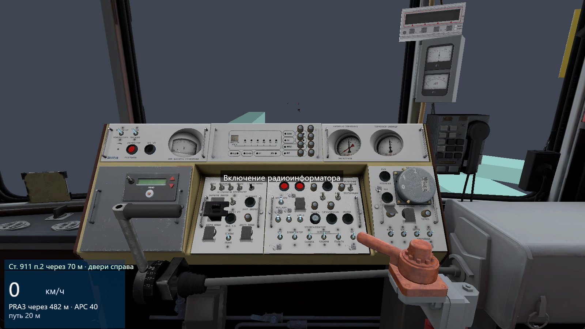
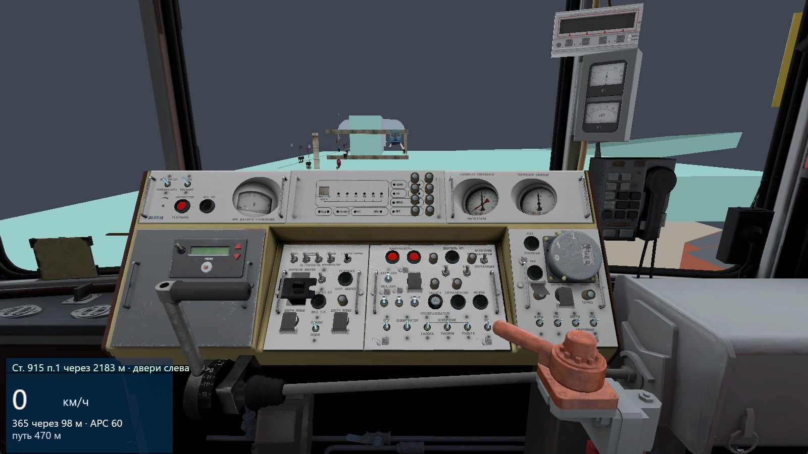
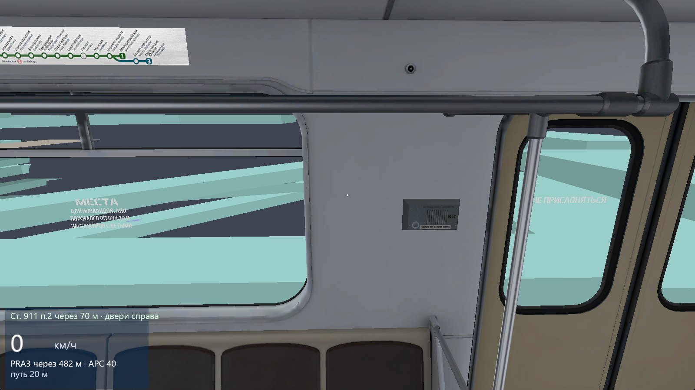

# Metrostroi-rs

Симулятор метро на **Rust + wgpu**, который запускает оригинальную кабину **81-717** и Lua-логику **Metrostroi**
прямо из файлов Steam Workshop (без конвертации): все 353 кнопки кабины работают, есть физика, трасса, сигналы и АРС,
станции, звук, меню и прогулки по вагону.

**Сайт проекта:** https://lakomoor.github.io/metrostroi-rs/



| | |
|---|---|
|  |  |

## Что нужно для запуска
Windows, Rust (MSVC), видеокарта с Vulkan/DX12 и **ваши подписки на контент Metrostroi в Steam Workshop** (Garry's Mod,
appid 4000). Программа читает модели, текстуры и звуки прямо из установки Steam; в репозитории их нет.

Подробности — [SETUP.md](SETUP.md). Для ИИ-агентов: [AGENTS.md](AGENTS.md) (Codex и др.) и [CLAUDE.md](CLAUDE.md).

```
git clone https://github.com/LakoMoor/metrostroi-rs
cd metrostroi-rs
# game/config/game.json -> "workshop": путь к .../steamapps/workshop/content/4000
# карту crossline_c4 извлеките из её GMA (см. SETUP.md, шаг 2)
cd sim
cargo build --release -p viewer
target/release/metrostroi-rs.exe --cab --at 300
```

## Контент и авторы
Весь игровой контент принадлежит его авторам; ссылки — это источники, которые нужно подписать в Steam:

| Workshop | Что |
|---|---|
| [1812142201](https://steamcommunity.com/sharedfiles/filedetails/?id=1812142201) | пакет контента Metrostroi |
| [1095094174](https://steamcommunity.com/sharedfiles/filedetails/?id=1095094174) | пакет контента Metrostroi |
| [1095098251](https://steamcommunity.com/sharedfiles/filedetails/?id=1095098251) | пакет контента Metrostroi |
| [1095100683](https://steamcommunity.com/sharedfiles/filedetails/?id=1095100683) | пакет контента Metrostroi |
| [1095105863](https://steamcommunity.com/sharedfiles/filedetails/?id=1095105863) | пакет контента Metrostroi |
| [1095109617](https://steamcommunity.com/sharedfiles/filedetails/?id=1095109617) | пакет контента Metrostroi |
| [1095111608](https://steamcommunity.com/sharedfiles/filedetails/?id=1095111608) | пакет контента Metrostroi |
| [1973160540](https://steamcommunity.com/sharedfiles/filedetails/?id=1973160540) | пакет контента Metrostroi |
| [261801217](https://steamcommunity.com/sharedfiles/filedetails/?id=261801217) | пакет контента Metrostroi |
| [1095130789](https://steamcommunity.com/sharedfiles/filedetails/?id=1095130789) | Lua-скрипты Metrostroi (лежат в `game/lua`) |
| [3018420076](https://steamcommunity.com/sharedfiles/filedetails/?id=3018420076) | текстуры карт Metrostroi |
| [674649096](https://steamcommunity.com/sharedfiles/filedetails/?id=674649096) | Gm_Mus_Loopline: туннельные модели и текстуры Metrostroi |
| [3340000198](https://steamcommunity.com/sharedfiles/filedetails/?id=3340000198) | карта gm_metro_crossline_c4 |

Идеи архитектуры взяты из [openOMSI](https://github.com/openOMSI-org/openOMSI) (AGPL-3.0), код не копировался.
Проект неофициальный и не связан с авторами Metrostroi и Garry's Mod.

## Состояние
См. [ROADMAP.md](ROADMAP.md) и [PLAN.md](PLAN.md). Сделано: форматы, рендер, Lua-хост, кабина 1:1, динамика, трасса,
сигналы и знаки, занятость блоков, станции, двери, звук, меню/HUD, подсказки, ходьба с коллизиями.
